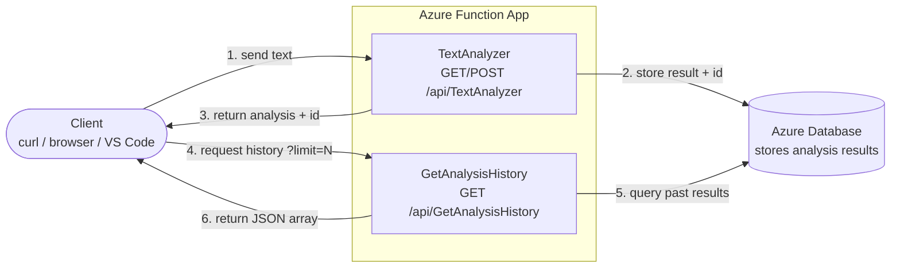

# CST8917 Lab 1 — Text Analyzer Azure Function

**Course:** CST8917 - Serverless Applications | Summer 2026
**Student:** Mimi Dib
**Student #:** 040829779

A Python (v2 model) Azure Function that analyzes text and persists each
result to an Azure database, plus a history endpoint to retrieve past results.

---

## Architecture



---

## Demo Video

📹 See [DEMO Video](https://youtu.be/SFqkzbxt4A4) for the YouTube link.

---

## Database Choice

🗄️ See [DATABASE_CHOICE.md](DATABASE_CHOICE.md) for the database I selected,
justification, alternatives considered, and cost notes.

- **Database used:** Azure Cosmos DB (serverless)
- **SDK package:** azure-cosmos
- **Database id:** `TextAnalyzerDB`
- **Container id:** `analyses`
- **Partition key:** `/id`

---

## Endpoints

| Method   | Route                     | Description                                                                 |
| -------- | ------------------------- | --------------------------------------------------------------------------- |
| GET/POST | `/api/TextAnalyzer`       | Analyzes text, stores the result, returns the analysis + stored record `id` |
| GET      | `/api/GetAnalysisHistory` | Returns past analyses as JSON. Optional `?limit=N` (default 10)             |

### Example requests

```bash
# Analyze text
curl "http://localhost:7071/api/TextAnalyzer?text=Serverless computing is amazing. It scales automatically."

# Retrieve history (all)
curl "http://localhost:7071/api/GetAnalysisHistory"

# Retrieve history (last 5)
curl "http://localhost:7071/api/GetAnalysisHistory?limit=5"
```

---

## Prerequisites

- Python 3.12
- Azure Functions Core Tools
- Azurite (local storage emulator)
- An Azure account + the database resource (see DATABASE_CHOICE.md)

---

## Environment Variables

These go in `local.settings.json` for local dev (gitignored — **never commit
secrets**) and in the Function App's **Application Settings** in Azure.

| Variable                     | Description                                    |
| ---------------------------- | ---------------------------------------------- |
| `FUNCTIONS_WORKER_RUNTIME`   | `python`                                       |
| `AzureWebJobsStorage`        | `UseDevelopmentStorage=true` (local/Azurite)   |
| `<DB_CONNECTION_STRING_VAR>` | Connection string/endpoint for the database    |
| `<DB_DATABASE_NAME>`         | <if applicable e.g. Cosmos DB: `TextAnalyzer`> |
| `<DB_CONTAINER_NAME>`        | <if applicable e.g. `analyses`>                |

Example `local.settings.json`:

```json
{
  "IsEncrypted": false,
  "Values": {
    "FUNCTIONS_WORKER_RUNTIME": "python",
    "AzureWebJobsStorage": "UseDevelopmentStorage=true",
    "DATABASE_CONNECTION_STRING": "your-connection-string-here"
  }
}
```

What each line does:

- **`IsEncrypted`** — plain-text local storage
- **`Values`** — the block loaded as env vars (read via `os.environ`)
- **`FUNCTIONS_WORKER_RUNTIME`** — the language runtime
- **`AzureWebJobsStorage`** — runtime's internal storage → Azurite locally
- **`DATABASE_CONNECTION_STRING`** — Cosmos connection (flagged as secret, never commit)

> Gitignored and not deployed — Azure reads the same names from the Function App's Application Settings.

---

## Run Locally

```bash
# 1. Create + activate a virtual environment
python -m venv .venv
.venv\Scripts\activate        # Windows
# source .venv/bin/activate   # macOS/Linux

# 2. Install dependencies
pip install -r requirements.txt

# 3. Start the storage emulator (separate terminal)
azurite --silent --location .azurite --debug .azurite/debug.log

# 4. Start the function
func start
```

Then hit the endpoints above at `http://localhost:7071`.

---

## Deploy to Azure

```bash
func azure functionapp publish <your-function-app-name>
```

Remember to add `<DB_CONNECTION_STRING_VAR>` (and any other env vars) under
**Function App → Settings → Environment variables** before testing in the cloud.

---

## Project Structure

```
.
├── function_app.py        # TextAnalyzer + GetAnalysisHistory functions
├── requirements.txt       # Python dependencies (incl. database SDK)
├── host.json
├── local.settings.json    # gitignored — secrets live here locally
├── DATABASE_CHOICE.md      # database selection + justification
├── DEMO.md                 # YouTube demo link
└── README.md
```

---

## Challenges & Lessons Learned

- **Azure Functions Core Tools wouldn't install via npm** — the npm package downloaded but never extracted `func.exe` (incompatible with Node 26). Fixed by installing the standalone build with `winget` instead, which ships the binary pre-extracted.
- **"No HTTP triggers found" on Azure** — the Python v2 model discovers functions by running the code (decorators), not from `function.json`. Deploying via the CLI didn't enable this, so I had to add the app setting `AzureWebJobsFeatureFlags = EnableWorkerIndexing` to the Azure function App Environment variables.
- **Cross-partition query error on `GetAnalysisHistory`** — because the partition key is `/id`, listing all history spans every partition. This raised `(BadRequest) Cross partition query is required but disabled. Please set x-ms-documentdb-query-enablecrosspartition to true...` in the logs. Fixed by passing `enable_cross_partition_query=True` to be able to call `query_items` when creating the items list.
- **Deployed app crashed at import** — `local.settings.json` is never deployed (as expected), so `DATABASE_CONNECTION_STRING` environment variable was missing in Azure since I hadn't added it yet so when Python loaded the file in Azure, the line that creates the with module-level `CosmosClient` threw on import. I thought what would've happened was the app would deploy but the request wouldn't execute,(possibly since I came from the compiled world of Java as my mother-tongue coding language, the compile would work but the run would fail in this instance since a null at runtime isn't a compile error) instead the import crash made trigger indexing find zero functions — the deploy logged "No HTTP triggers found" and **none** of the functions registered at all (not even `TextAnalyzer`). Fixed by adding the connection string as an **App Setting** in the Function App (same name as locally).

**Key takeaway:** module-level code runs at import, so any error there (a missing env var, a failed import) breaks trigger indexing for _every_ function — surfacing as "No functions / triggers found" rather than an obvious error.

---
